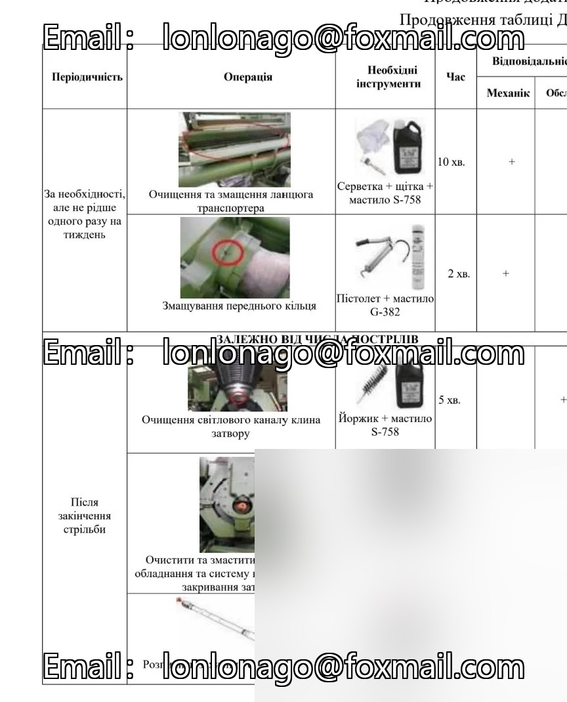
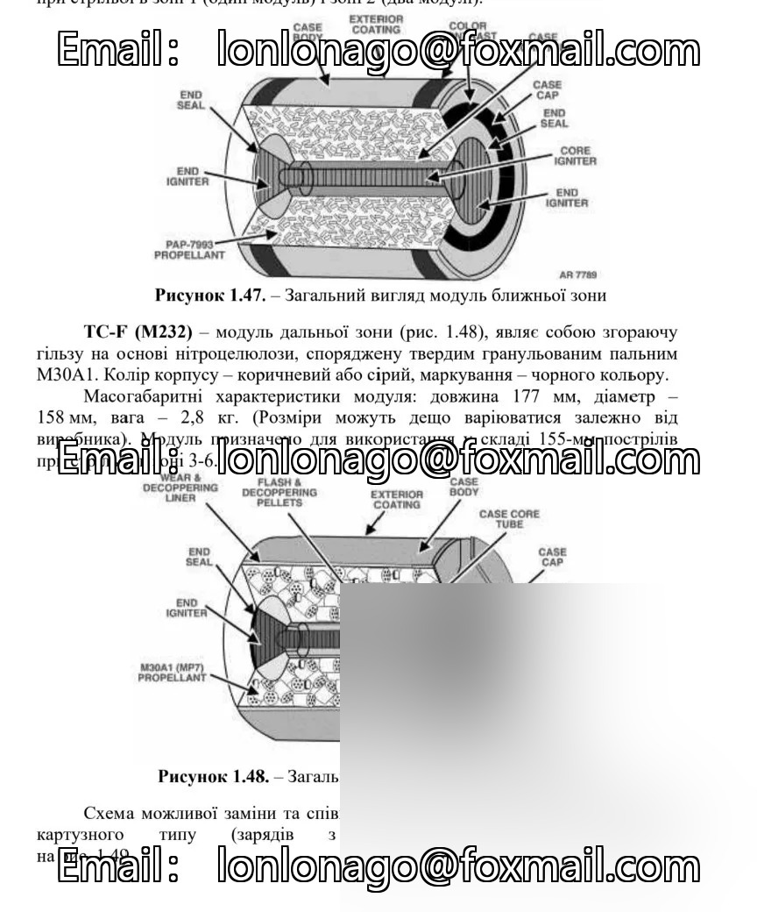
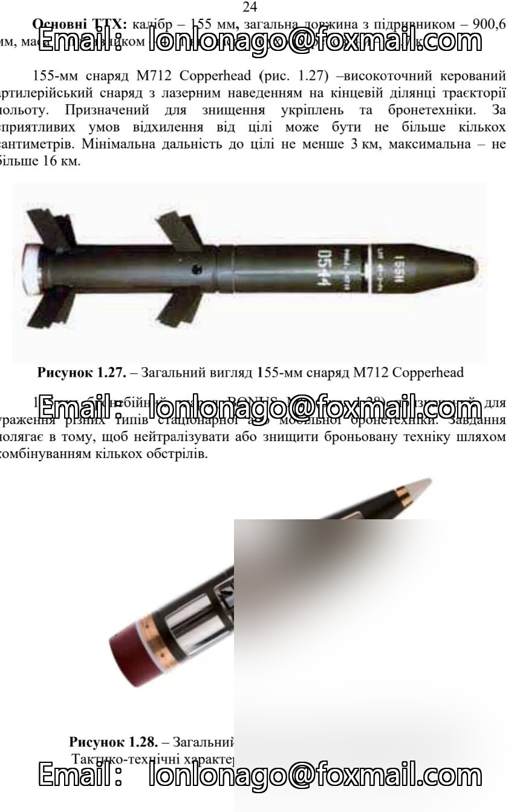
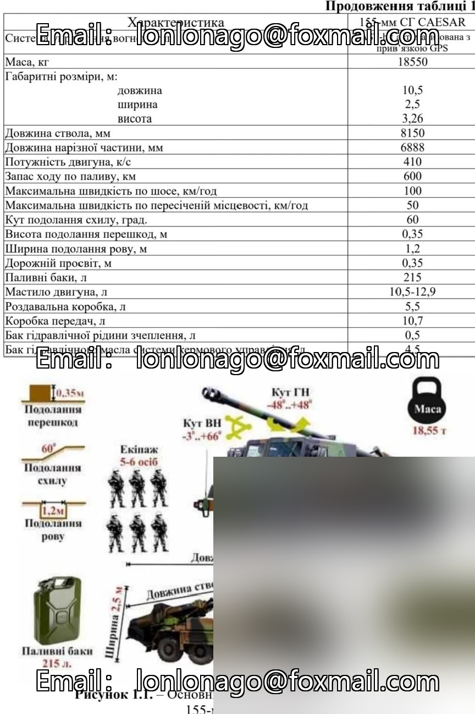
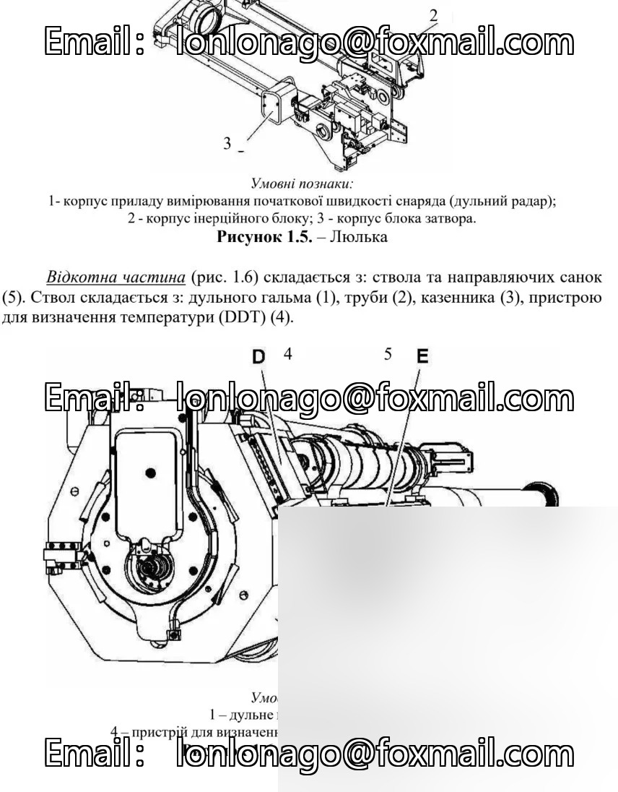

# Caesar grenade cannon

## Body

The of the Operation/Training Manual PDF of the 155mm "Caesar" (CAESAR) self-assault gun of the Ukraine Ministry of Defense released in June 2023, 90 pages, complete content, suitable for reference by military enthusiasts and researchers.

The materials include:
- Chapter 1: Basic construction of the gunpowder, tactical and technical characteristics
- Chapter 2: Formation and responsibilities of the cannon battalion
- Chapter 3: Requirements for shooting preparation
- Chapter 4: Operations in positions
- Chapter 5: Coordination with drones
- Appendix: Ammunition marking, shooting parameters, maintenance cycles

no return upon sale. If you need to take a photo directly, contact privately for any issues.

CAESAR is a 155-mm self-propelled grenade launcher released by the Ukrainian Ministry of Defense in June 2023; its operation and training manual PDF covers 90 pages and includes operation, training, and related content.

<!-- AI_ENRICHED -->

## Images

## Payment

Here is a pay link on Stripe ( https://buy.stripe.com/3cs8yP7sY87d0vu9AB ). Please contact me lonlonago@foxmail.com after funding $89, and I will send you a complete data files , thank you!

